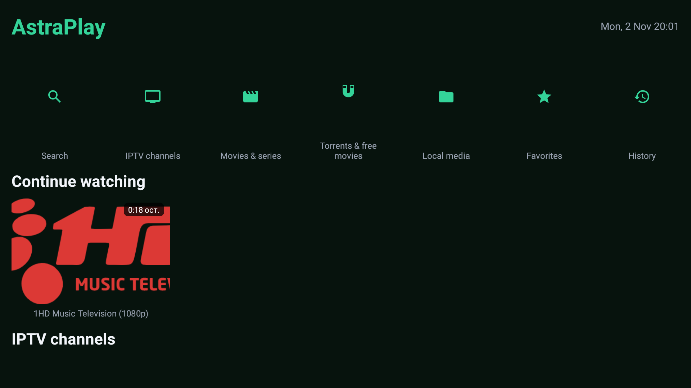
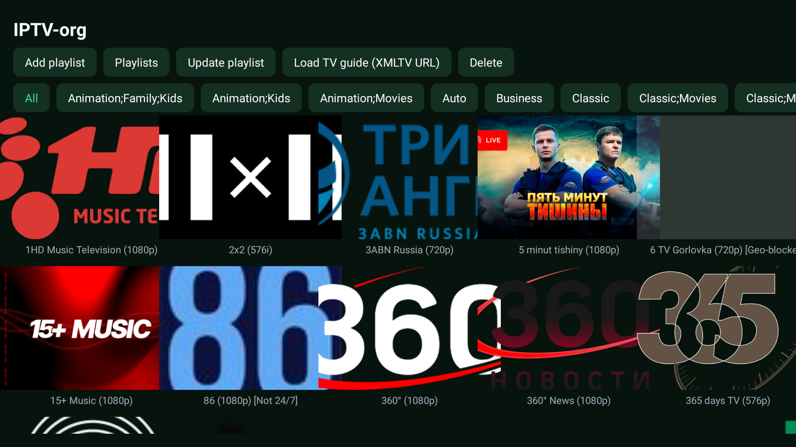
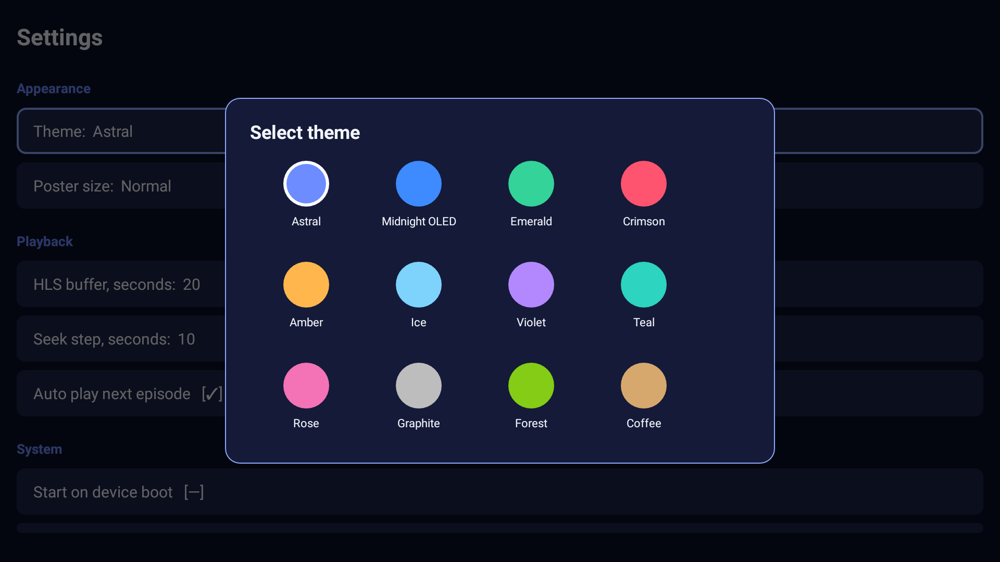
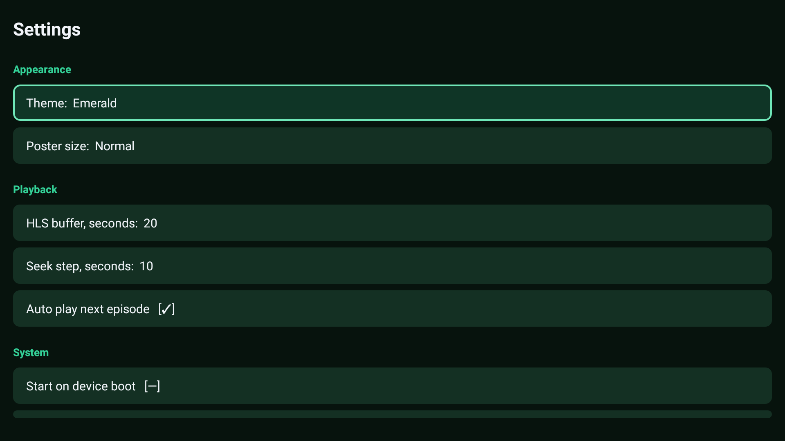

# AstraPlay


Бесплатный медиа-центр для Android TV: IPTV-плейлисты, каталог фильмов и
сериалов (TMDB), поиск свободного кино и торрентов, локальные видео,
избранное и история. **Все функции бесплатны — без рекламы, подписок и
Pro-версий.**

Аналог LazyMedia Deluxe, написанный с нуля на Kotlin и оптимизированный
под слабые TV-приставки: **Android 7.0+ (API 24), от 1 ГБ RAM**.

## 📸 Скриншоты

| Главный экран | IPTV-каналы | Плеер |
|:---:|:---:|:---:|
|  |  |  |

| 12 тем | Настройки |
|:---:|:---:|
|  |  |

## 📥 Установка

Скачайте [`AstraPlay-v1.1-universal.apk`](https://github.com/Vasyarot/AstraPlay/releases/latest)
из Releases и установите на приставку/ТВ (разрешите установку из
неизвестных источников). Один APK покрывает **Android 7.0–14 и все
архитектуры** (ARM/x86 — приложение без нативного кода).

## Сборка

Требуется JDK 17 и Android SDK (или просто Android Studio).

```bash
./gradlew assembleDebug      # отладочный
./gradlew assembleRelease    # подписанный release с R8
```

На CI (GitHub Actions, `.github/workflows/release.yml`) release собирается
автоматически на каждый тег `v*` и публикуется в Releases. Без файла
`app/astraplay.keystore` (не публикуется) CI-сборка подписывается
debug-ключом.

## Что внутри

| Модуль | Описание |
|---|---|
| IPTV | m3u/m3u8-плейлисты (URL/файл), группы каналов, логотипы, телепрограмма XMLTV (EPG) |
| Каталог | TMDB: тренды/популярное/топы, поиск, детали, трейлеры, сезоны и серии |
| Торренты и свободное кино | Internet Archive (public domain): прямые mp4-ссылки для стрима + .torrent для внешних приложений |
| Локальные медиа | видео с устройства и USB через MediaStore, превью-кадры |
| Плеер | Media3/ExoPlayer: HLS, resume-позиции, звуковые дорожки, субтитры, шаг перемотки, автопереход к сериям |
| Данные | избранное (по типам), история, «Продолжить просмотр», отметки о просмотре, бэкап/восстановление в JSON |
| ТВ | leanback-лаунчер, баннер, глобальный/голосовой поиск Android TV, автозапуск при загрузке |
| Оформление | **12 цветовых тем** (Astral, Midnight OLED, Emerald, Crimson, Amber, Ice, Violet, Teal, Rose, Graphite, Forest, Coffee), 2 размера постеров |

## Оптимизации под 1 ГБ RAM

- **Ноль тяжёлых зависимостей**: нет Room (чистый SQLite), нет RxJava
  (корутины), нет Leanback-фрагментов (свой лёгкий TV-UI), нет Google
  Services/рекламы — APK и старт приложения кратно меньше оригинала.
- Coil: **RGB_565** (постеры вдвое легче), кэш памяти 12%, дисковый кэш 64 МБ.
- Общий `RecycledViewPool` для всех рядов карточек.
- EPG хранит только окно ±сутки в памяти; история — не более 300 записей.
- Плеер: настраиваемый HLS-буфер (по умолчанию 20 с), `largeHeap=false`.
- R8 full mode + сжатие ресурсов в release.

## Архитектура

```
app/src/main/java/com/astraplay/tv/
├── App.kt                    # глобальные настройки (Coil и пр.)
├── core/                     # ServiceLocator, Prefs
├── data/
│   ├── db/                   # SQLite: Store (плейлисты, каналы, избранное, история, позиции)
│   ├── iptv/                 # M3uParser, EpgStore (XMLTV)
│   ├── tmdb/                 # TmdbClient
│   ├── torrent/              # ArchiveSource (Internet Archive)
│   ├── local/                # MediaStoreSource
│   └── net/                  # OkHttp-обёртка
├── ui/
│   ├── common/               # PosterCard, MediaRow, Dialogs, dp/фокус-хелперы
│   ├── theme/                # ThemeManager (12 тем)
│   ├── home/                 # главный экран-дашборд
│   ├── iptv/  movies/  torrent/  local/  data/  search/  settings/  nav/
├── player/PlayerActivity.kt  # Media3
└── tv/                       # SearchProvider (глобальный поиск), BootReceiver
```

## Добавление своих источников поиска

`data/torrent/ArchiveSource` — реализация интерфейсного контракта
`search(query, page): Result<List<...>>` + `files(id): Result<List<...>>`.
Добавьте свой класс по образцу (другой открытый каталог, ваш NAS и т.п.)
и подключите в `TorrentActivity`.

## Возможные доработки (v2)

- SMB/FTP-просмотр сетевых папок
- Синхронизация через WebDAV (без Google-зависимостей)
- Встроенная EPG-сетка на весь экран
- Профили/детские ограничения
